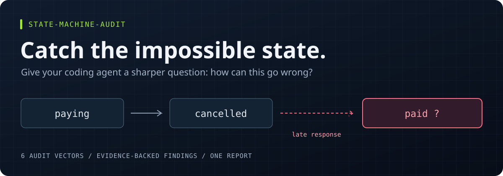

# state-machine-audit

<div align="center">



### Find the states your app was never supposed to reach.

An Agent Skill for state machines, race conditions, and the bugs between events.

[](LICENSE)
[](skills/state-machine-audit/SKILL.md)
[](#what-it-catches)
[](package.json)

**[Get started](#quick-start) &nbsp; / &nbsp; [See the results](#tested-against-bugs-with-known-answers) &nbsp; / &nbsp; [Explore a report](skills/state-machine-audit/references/report-template.md)**

</div>

---

## "That state should be impossible."

A cancelled checkout turns "paid." A slow request replaces the profile you just opened. A background job says "done," but the work never finished.

These bugs live between events. Each function can look reasonable on its own.

`state-machine-audit` gives your coding agent a repeatable way to investigate them. It traces state transitions, async work, and persisted data, then writes an evidence-backed `REPORT.md` with the code, the failure scenario, and a proposed fix.

| Trace the failure | Bring the evidence | Make it actionable |
| :--- | :--- | :--- |
| Follow transitions, cancellations, and late responses. | Cite real code with verified locations. | Get severity, a failure scenario, and a structural fix. |

> **One new report. Your application code stays untouched.** The skill instructs your agent to investigate first; you decide which fixes to take on.

## Quick start

**1. Install the skill.**

Install with the [Skills CLI](https://github.com/vercel-labs/skills) using Node.js 22.20 or newer:

```bash
npx skills add adityaarakeri/state-machine-audit --skill state-machine-audit -g
```

Choose your coding agent when prompted. Omit `-g` to install only in the current project.

**2. Open your repository and ask.**

Start a fresh agent session in the repository you want audited:

```text
Use the state-machine-audit skill on this repository.
Focus on checkout, payment status transitions, and stale async responses.
Do not change application code. Write an evidence-backed report with
exact file locations, verbatim snippets, and structural fixes.
State the audited scope and any skipped modules.
```

Replace the focus areas with yours: background jobs, authentication, uploads, subscriptions, or whatever keeps producing "can't reproduce" tickets.

**3. Read the evidence.**

The output is `REPORT.md` at the repository root. If a report already exists, the skill instructs the agent to use a fresh filename. Review the findings, then request fixes separately.

Want to try it before pointing it at your app? Open `evals/fixtures/react-shop/` in your agent and run the same request. It contains deliberately planted bugs and correct code that should be left alone. Keep `evals/expected/` out of the agent's context.

## The kind of bug this is for

Imagine a checkout with a payment request still in flight:

```text
1. Customer clicks Pay.              status = paying
2. Customer cancels.                 status = cancelled
3. The old payment request returns.  status = paid
```

The last assignment might be perfectly valid TypeScript. The problem is whether that operation still has permission to change the state.

A useful audit follows the whole sequence: who starts the work, who can cancel it, what happens when it finishes, and whether an existing guard prevents the stale write. It then proposes a fix that fits the lifecycle, such as checking operation identity and enforcing legal transitions in one place.

That's the question behind this skill: **can the system reach a state nobody designed for?**

## What it catches

| Audit area | What can go wrong |
| --- | --- |
| **Contradictory flags** | `isLoading`, `isError`, and `isSuccess` describe one operation but can disagree. |
| **Unguarded transitions** | Several modules write a status field, allowing a cancelled job to become running again. |
| **Async races** | An older response arrives last and overwrites newer data. |
| **Side-effect failures** | An order is marked paid before the charge succeeds, leaving state and reality out of sync. |
| **Unchecked hydration** | Old database rows or localStorage values enter the app as states the current code no longer understands. |
| **Scattered recovery logic** | Logout, cancellation, or retry handling differs across modules and leaves parts of the app behind. |

You don't need a state-machine library to use it. Status strings, enums, boolean flags, reducers, and worker lifecycles all give the audit something to follow.

The [audit reference](skills/state-machine-audit/references/audit-vectors.md) contains the detailed checks and language-specific search leads.

## What you get back

Every finding must include:

- **Evidence:** file locations, confirmed line ranges, and verbatim code snippets.
- **A failure scenario:** the sequence of events that triggers the problem and what breaks.
- **Severity:** Critical, Moderate, or Minor, using a shared rubric.
- **A structural fix:** a recommendation in the project's own language and idioms.

The report also includes a state-machine inventory, the scope covered, skipped areas, and a prioritized remediation roadmap. See the [report template and worked finding](skills/state-machine-audit/references/report-template.md) for the full format.

The instructions require evidence for every finding and exclude praise disguised as a warning. Independent UI toggles are not automatically "boolean soup." A race that an existing cancellation guard already prevents is not a finding.

## Tested against bugs with known answers

The repository includes small TypeScript and Python projects with planted defects, correct decoys, secret canaries, and an existing report that must survive the audit.

The recorded **v1.1.0 confirmation batch** used fresh headless Claude Code sessions:

<div align="center">

**6 / 6 fixture runs passed &nbsp; | &nbsp; 0 decoys flagged &nbsp; | &nbsp; 0 invented snippets**

Small TypeScript and Python fixtures. Full results below.

</div>

| Fixture | Runs passed | Required bugs found per run | Decoys flagged | Invented snippets |
| --- | --- | --- | --- | --- |
| React shop / TypeScript | 3 of 3 | 6 of 6 | 0 | 0 |
| Job queue / Python | 3 of 3 | 5 of 5 | 0 | 0 |
| Both fixtures via the `AGENTS.md` adapter | 2 of 2 | All required bugs | 0 | 0 |

The first draft passed only 2 of 4 runs. Those failures helped tighten the instructions and expose scorer bugs. The [evaluation history](evals/RESULTS.md) records the changes and results.

**These are small-fixture results, not a guarantee for your codebase.** Other agents, large repositories, and languages beyond TypeScript and Python have not been validated by these runs. The suite checks recall, false positives, snippet accuracy, file integrity, report structure, and secret leaks. [See how scoring works](evals/README.md).

## Agent support and installation options

The source is an Agent Skill: a `SKILL.md` file plus supporting references. The repository also generates adapters for tools that consume rules, prompt files, or repository instructions. Packaging support is broader than the agents covered by the evaluations above.

### Install from source

<details>
<summary><strong>Clone, validate, and install for your agent</strong></summary>

Repository scripts require Node.js 18 or newer, with no npm dependencies. The installer also needs Bash; on Windows, use Git Bash or WSL.

```bash
git clone https://github.com/adityaarakeri/state-machine-audit.git
cd state-machine-audit
npm run check
bash scripts/install.sh --agent claude
```

Use `--agent codex` for the shared `.agents/skills` location. With no agent argument, the installer writes to both `~/.claude/skills` and `~/.agents/skills`.

For a project installation, run the installer from the **target repository**:

```bash
bash /path/to/state-machine-audit/scripts/install.sh --project --agent codex
```

Reopen your agent after installing. The installer replaces an existing copy of this skill at its destination.

</details>

### Generated adapters

<details>
<summary><strong>Cursor, Copilot, Gemini, AGENTS.md, and standalone prompts</strong></summary>

Run `npm run build` from this repository to generate:

| Format | Generated file |
| --- | --- |
| Cursor rule | `dist/cursor/.cursor/rules/state-machine-audit.mdc` |
| Copilot prompt | `dist/copilot/.github/prompts/state-machine-audit.prompt.md` |
| Gemini instructions | `dist/GEMINI.md` |
| Agent instructions | `dist/AGENTS.md` |
| Standalone prompt | `dist/prompt/state-machine-audit.md` |

Copy the relevant rule or prompt into your target project. For `AGENTS.md` or `GEMINI.md`, merge the generated instructions if that file already exists. All adapters include the references, so they can stand alone.

</details>

The [interactive runbook](index.html) covers installation, the checkout example, report verification, and troubleshooting. Download or open it locally in a browser; it needs no external assets.

<details>
<summary>Custom install locations, live editing, and removal</summary>

Override the bundled installer's destination:

```bash
SKILL_TARGETS="$HOME/.some-agent/skills" bash scripts/install.sh
```

Use `npm run dev` to symlink the skill into the default user locations while editing it.

To remove a bundled installation, repeat its scope and agent options with `--uninstall`:

```bash
bash scripts/install.sh --agent claude --uninstall
```

For a Skills CLI installation, use `npx skills remove` and select the matching skill, agent, and scope.

</details>

## How it works

The skill gives your agent a five-step workflow: map the codebase, investigate six audit vectors, rate confirmed defects, write the report, and verify its evidence and file changes.

The main instructions live in [`SKILL.md`](skills/state-machine-audit/SKILL.md). Search guidance, the severity rubric, and the report template live in `references/` and are loaded as needed. The build script bundles those same sources into each adapter.

"Read-only" is an instruction to the agent, not a filesystem sandbox. The audit is allowed to write one new report and is instructed to leave existing files alone. Compare the final diff with your pre-audit changes when reviewing the result.

For large repositories, the workflow scopes the audit to a few modules with substantial state activity and records what it skipped. A clean report applies to that scope; it does not establish that the whole app is bug-free.

## Contributing

Found a state bug the skill missed? A small reproduction is especially useful. Include the expected behavior, the event ordering that breaks it, and the agent you used. Remove credentials and private code before sharing.

Good contributions include new language fixtures, correct-code decoys, clearer audit rules, and evaluation runs with other agents. Start with [the evaluation guide](evals/README.md) if you're adding a fixture.

```bash
npm run check        # validate instructions, test the scorer, build adapters
npm run eval:claude  # run real audits against the fixtures
```

The real-agent evaluations require the corresponding CLI and authentication. Presets also exist as `npm run eval:codex` and `npm run eval:gemini`.

Edit sources under `skills/`; `dist/` is generated. Keep findings grounded in a reproducible failure, and add a decoy when a new rule risks flagging valid code.

---

<div align="center">

### Found a bug before your users did?

**Give the repo a star so you can find it for the next review.**

[Report a missed bug](https://github.com/adityaarakeri/state-machine-audit/issues) &nbsp; / &nbsp; [Add a fixture](evals/README.md) &nbsp; / &nbsp; [Read the changelog](CHANGELOG.md)

</div>

## License

[MIT](LICENSE). Use it, adapt it, and bring your own suspicious status field.
